<p align="center">
  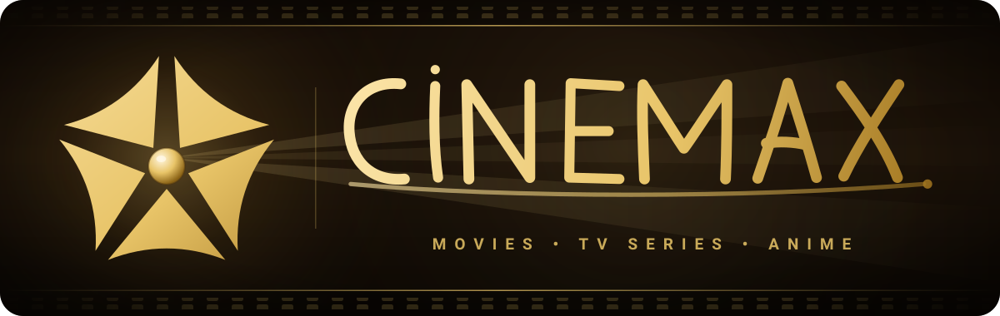
</p>

<p align="center">
  <b>Movies · TV Series · Anime · Arabic Cinema — in one beautiful app.</b><br>
  <sub>Built with Flutter & native Kotlin · Many servers & qualities up to 4K · Premium streaming experience</sub>
</p>

<p align="center">
  
  
  
  
  
</p>

<p align="center">
  
  
  
  
</p>

---

## 📑 Table of Contents

- [📥 Download](#-download)
- [📝 Overview](#-overview)
- [📸 Visual Showcase & Screenshots](#-visual-showcase--screenshots)
  - [1. Discovery & Categories](#1-discovery--categories)
  - [2. Details & Previews](#2-details--previews)
  - [3. Video Player Experience](#3-video-player-experience)
  - [4. Notifications & Updates](#4-notifications--updates)
- [✨ Key Features](#-key-features)
- [📂 Project Structure](#-project-structure)
- [🎨 Brand Identity](#-brand-identity)
- [⚠️ Disclaimer](#️-disclaimer)

---

## 📥 Download

<p align="center">
  <a href="https://github.com/M0SAD67/CinMax/releases/latest">
    
  </a>
  <br><br>
  <a href="https://github.com/M0SAD67/CinMax/releases"><b>📜 Browse all releases & changelogs</b></a>
</p>

| Requirement | Details |
|---|---|
| 📱 Platform | Android 7.0 (API 24) or higher |
| 🧠 Architectures | `arm64-v8a`, `armeabi-v7a`, `x86_64` |
| 🌐 Network | Internet connection required (downloaded media works 100% offline) |

---

## 📝 Overview

**CineMax** is a premier streaming and media discovery application built with **Flutter** and enhanced by hardware-accelerated **Kotlin** native components. It brings thousands of movies, television series, anime episodes, and Arabic cinema titles together in a cohesive, fluid, cinematic interface — with **many streaming servers** and **qualities up to 4K**.

Equipped with real-time **Watch Parties**, an integrated **Gemini AI Assistant**, background downloads, and a feature-packed player with native Picture-in-Picture, CineMax delivers an uncompromising cinematic experience on mobile and tablet devices.

> [!NOTE]
> CineMax incorporates an ultra-smooth **5-blade aperture intro** written in 100% hardware-accelerated vector paths, ensuring an immediate 60/120 FPS startup.

---

## 📸 Visual Showcase & Screenshots

### 1. Discovery & Categories
Explore endless entertainment through tailored feeds, intelligent search, and dedicated sections for Anime and Arabic cinema.

<table>
  <tr>
    <td align="center" width="25%">
      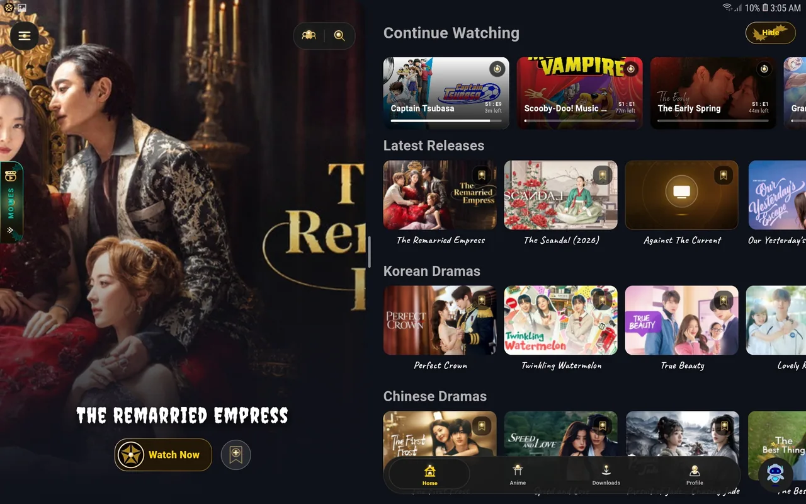<br>
      <b>🏠 Home & Featured</b><br>
      <sub>Curated banners, continue watching & trending collections</sub>
    </td>
    <td align="center" width="25%">
      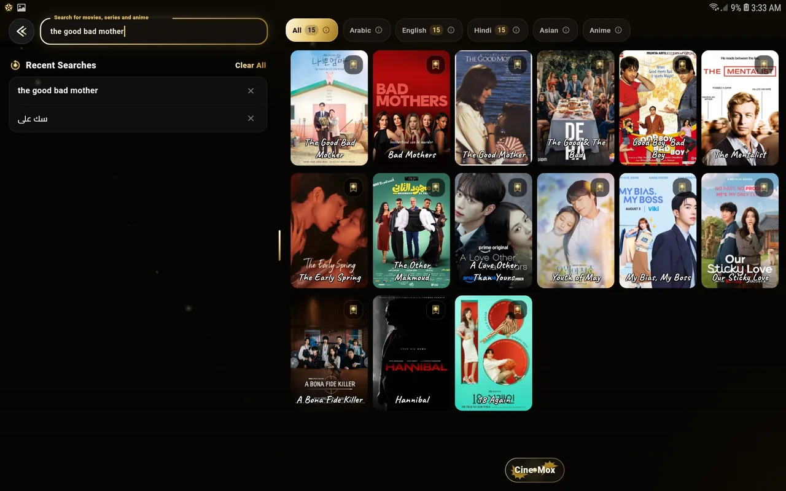<br>
      <b>🔍 Smart Search</b><br>
      <sub>Instant results with category filters</sub>
    </td>
    <td align="center" width="25%">
      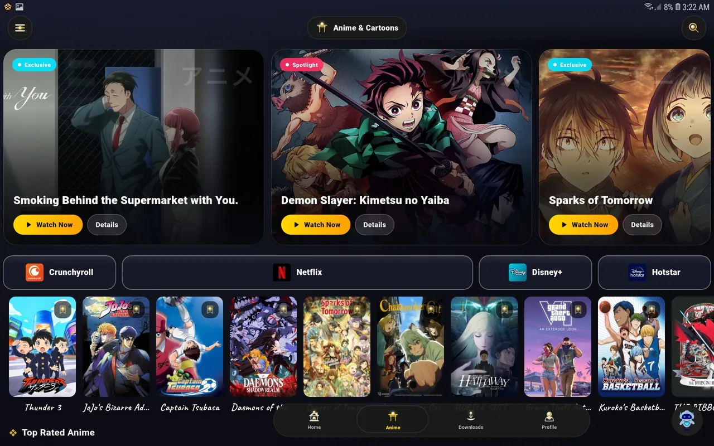<br>
      <b>🍥 Anime Hub</b><br>
      <sub>Subbed & dubbed anime series, seasons & latest episodes</sub>
    </td>
    <td align="center" width="25%">
      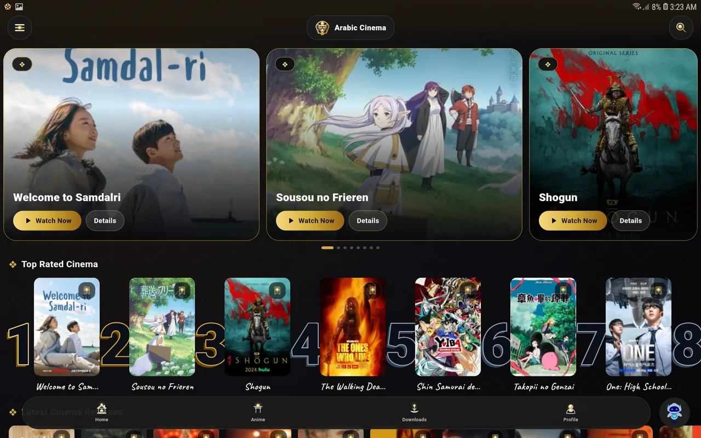<br>
      <b>🎭 Arabic Cinema</b><br>
      <sub>Rich regional Arabic library, classics & Ramadan releases</sub>
    </td>
  </tr>
</table>

---

### 2. Details & Previews
Comprehensive media metadata, episode guides, seamless trailer previews, and custom subtitle selections.

<table>
  <tr>
    <td align="center" width="33%">
      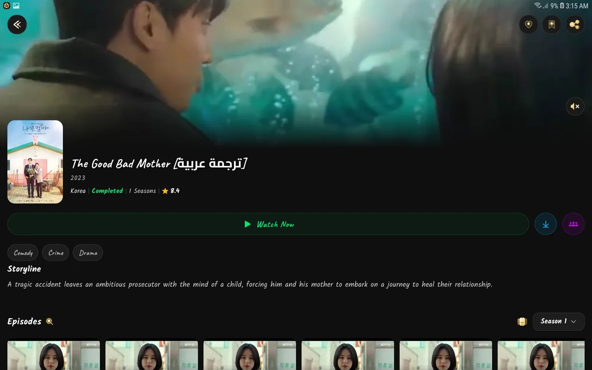<br>
      <b>📋 Content Overview</b><br>
      <sub>Cast, synopsis, IMDb ratings & seasons breakdown</sub>
    </td>
    <td align="center" width="33%">
      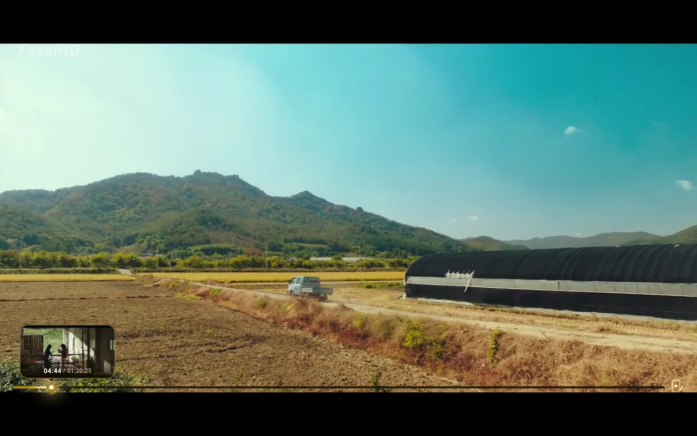<br>
      <b>🎬 In-App Video Previews</b><br>
      <sub>Instant high-definition teaser & trailer streaming</sub>
    </td>
    <td align="center" width="33%">
      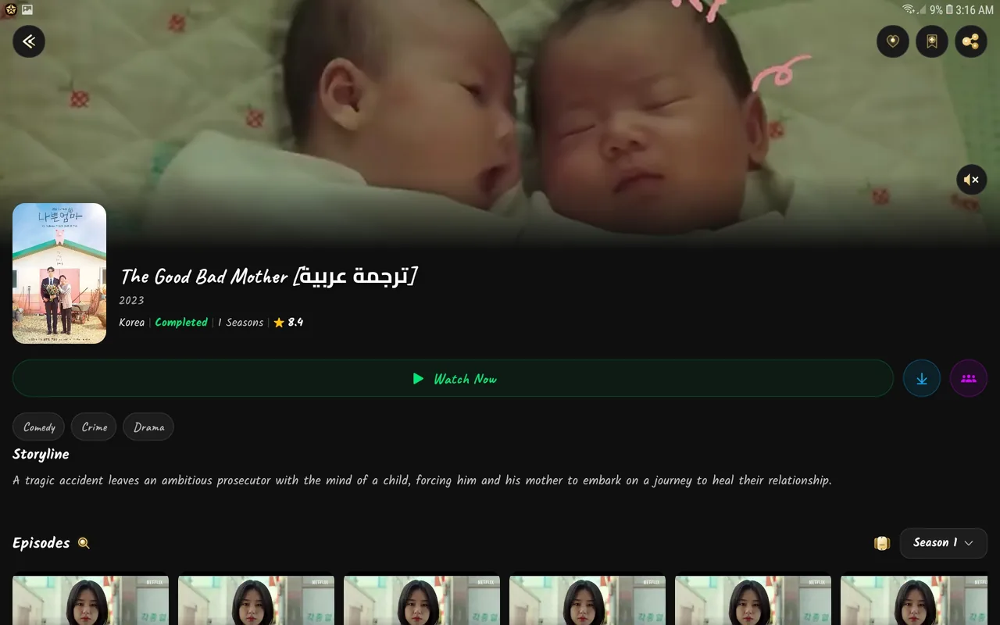<br>
      <b>📝 Subtitles & Audio</b><br>
      <sub>Multiple language tracks with full Arabic subtitle support</sub>
    </td>
  </tr>
</table>

---

### 3. Video Player Experience
A powerful player packed with many servers, qualities up to 4K, gesture navigation, and fullscreen landscape immersion.

<p align="center">
  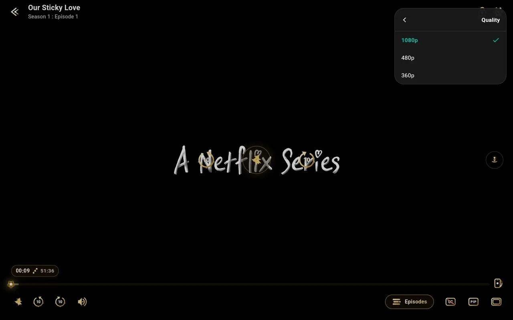<br>
  <b>🖥️ Cinema Landscape Mode</b><br>
  <sub>Full gesture controls (brightness, volume, seek), audio track selection, and aspect ratio calibration</sub>
</p>

<table>
  <tr>
    <td align="center" width="33%">
      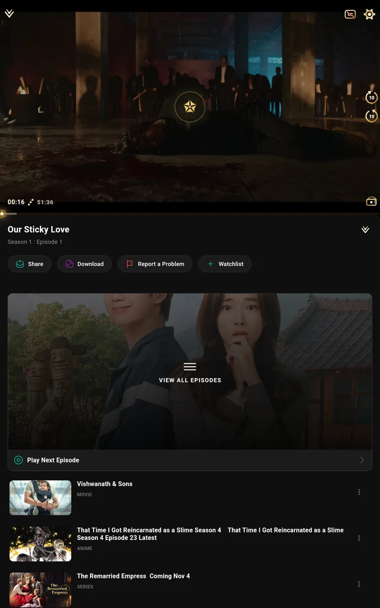<br>
      <b>📱 Portrait Player</b><br>
      <sub>Comfortable one-handed vertical viewing experience</sub>
    </td>
    <td align="center" width="33%">
      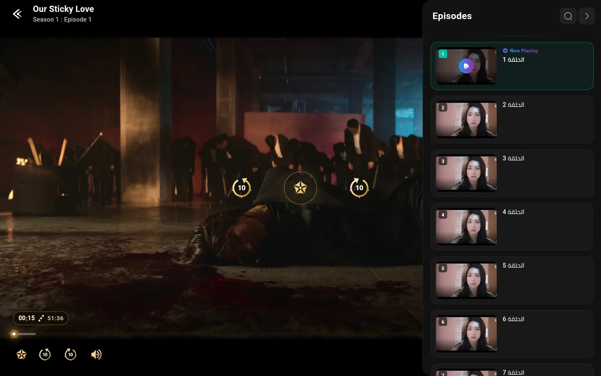<br>
      <b>📑 In-Player Episode Drawer</b><br>
      <sub>Switch episodes and seasons without interrupting playback</sub>
    </td>
    <td align="center" width="33%">
      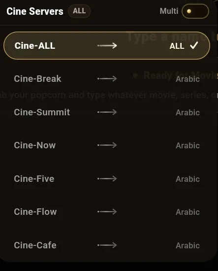<br>
      <b>⚡ Server & Quality Switcher</b><br>
      <sub>Many servers to choose from, with qualities up to 4K</sub>
    </td>
  </tr>
</table>

---

### 4. Notifications & Updates
Never miss a release with timely in-app notifications and system push alerts when new episodes air.

<table>
  <tr>
    <td align="center" width="50%">
      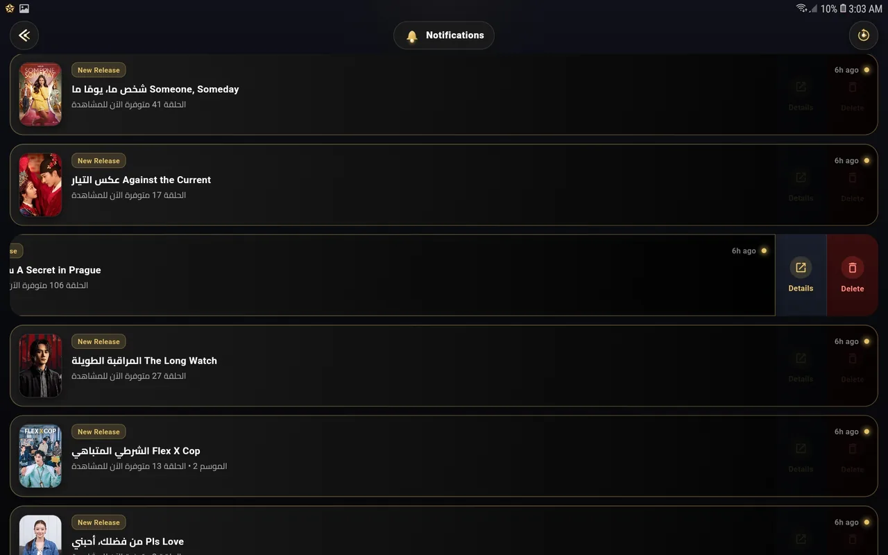<br>
      <b>🔔 In-App Release Center</b><br>
      <sub>Organized activity feed of newly released episodes</sub>
    </td>
    <td align="center" width="50%">
      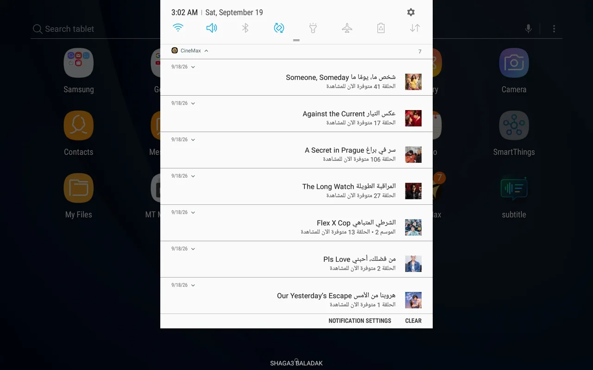<br>
      <b>📲 Native Push Notifications</b><br>
      <sub>Instant lock-screen and status bar alerts via Firebase Cloud Messaging</sub>
    </td>
  </tr>
</table>

---

## ✨ Key Features

### 🎬 Streaming & Catalog
- 🌐 **Many Servers**: Lots of streaming servers to choose from, so there's always one that works.
- 📺 **Qualities up to 4K**: Pick the quality that fits your screen and connection — from SD all the way up to 4K.
- 🎯 **Unified Catalog**: Browse movies, multi-season TV shows, anime, and Arabic productions in one place.
- 🎞️ **Inline Trailers**: Video previews and official trailers without leaving the details page.

### ▶️ Player Features
- 🖼️ **Picture-in-Picture (PiP)**: Keep watching in a floating window with play/pause controls.
- 🎚️ **Intuitive Gestures**: Swipe for brightness (left) and volume (right); horizontal swipe to seek.
- 📝 **Subtitles**: Load custom subtitles and adjust style, size, color, and sync delay.
- 📑 **In-Player Episode List**: Switch episodes and seasons without leaving the player.
- 🔁 **Auto-Play Next Episode**: Seamless binge-watching.
- ⏯️ **Resume Playback**: Continue exactly where you left off.

### 👥 Watch Party & AI
- 🎉 **Watch Party Rooms**: Synchronized playback with friends plus real-time live chat.
- 🤖 **Gemini AI Companion**: Smart assistant that recommends titles based on mood, genre, and watch history.

### 📥 Offline & Account Sync
- 💾 **Downloads**: Save episodes and movies in your preferred quality for offline viewing.
- ☁️ **Cloud Sync**: Favorites, watchlists, and watch progress synced across devices.

### 🎨 Design & Accessibility
- 🌙 **Glassmorphic UI**: Cinema-tuned dark and light themes with dynamic poster-extracted color accents.
- 🌍 **9 Languages**: Full RTL and LTR localization.

---

## 📂 Project Structure

```bash
lib/
├── ⚙️ config/               # App constants, routes & theme definitions
├── 🌍 l10n/                 # Localization files (9 languages, .arb)
├── 📦 models/               # Domain data models (Movie, Episode, Room...)
├── 🏗️ providers/            # State management (Provider pattern)
├── 📱 screens/
│   ├── auth/               # Login, registration & profile
│   ├── player/             # Custom video player & controls
│   ├── home_screen.dart    # Primary content hub
│   └── details_screen.dart # Media details & season listing
├── 🛠️ services/
│   ├── sources/            # Content & servers providers
│   ├── ai_service.dart     # Gemini AI recommendation prompts
│   ├── auth_service.dart   # Firebase authentication layer
│   └── download_service.dart # Background download manager
├── 🔧 utils/                # Error handling, network helpers & responsiveness
├── 🧩 widgets/              # Reusable UI cards, sheets & player controls
├── firebase_options.dart   # Firebase CLI configuration
└── main.dart               # Flutter application entry point

android/app/src/main/kotlin/mo/egy/cinemax/
├── MainActivity.kt         # PiP handling, method channels & intro orchestration
├── CinemaxIntroView.kt     # Hardware-accelerated 5-blade vector intro animation
├── VideoPreviewHandler.kt  # Native preview rendering
└── ShareActivities.kt      # Native Android share targets
```

---

## 🎨 Brand Identity

The CineMax brand combines modern cinema aesthetics with an iconic **5-blade golden camera aperture** and **custom calligraphy typography**.

<p align="center">
  
  &nbsp;&nbsp;&nbsp;&nbsp;&nbsp;&nbsp;&nbsp;&nbsp;
  
</p>

| Brand Property | Specification | Preview |
|---|---|---|
| **Primary Gold** | `#E8C468` |  `#E8C468` |
| **Light Gold Accent** | `#FCE6AC` |  `#FCE6AC` |
| **Deep Bronze Gold** | `#9C6F19` |  `#9C6F19` |
| **Cinema Dark Base** | `#1A1006` |  `#1A1006` |
| **Vector Emblem** | 5-blade aperture with optical center lens | [`cinemax_logo.svg`](assets/branding/cinemax_logo.svg) |
| **Calligraphy Wordmark** | Native vector paths from intro animation | [`cinemax_wordmark.svg`](assets/branding/cinemax_wordmark.svg) |

---

## ⚠️ Disclaimer

**CineMax** does not host, upload, or store any media or video files on its servers. The application only links to content available on publicly accessible third-party websites. CineMax and its creators bear no responsibility for the content, licensing, or compliance of third-party sites.

---

<p align="center">
  <br>
  <b>CineMax</b> — Crafted with ❤️ by the CineMax Team
</p>
